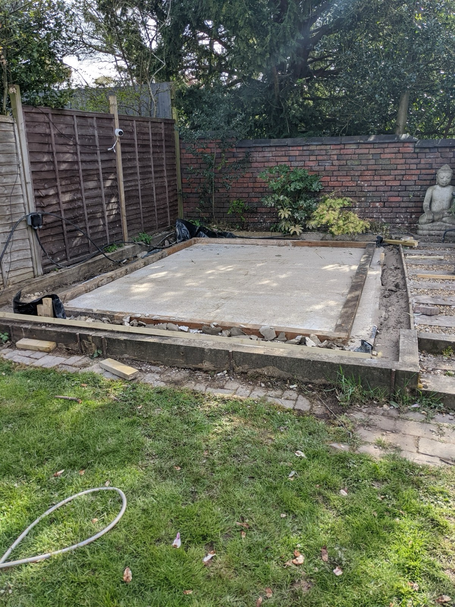
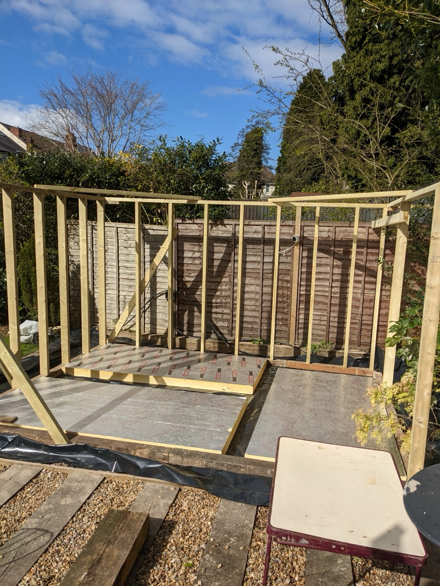
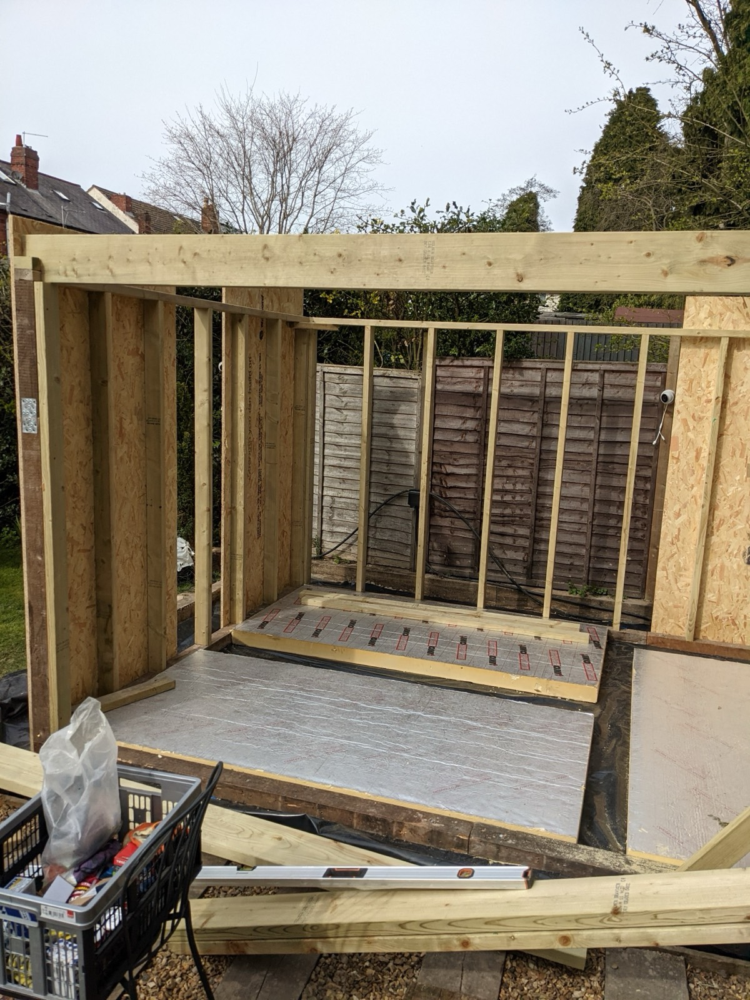
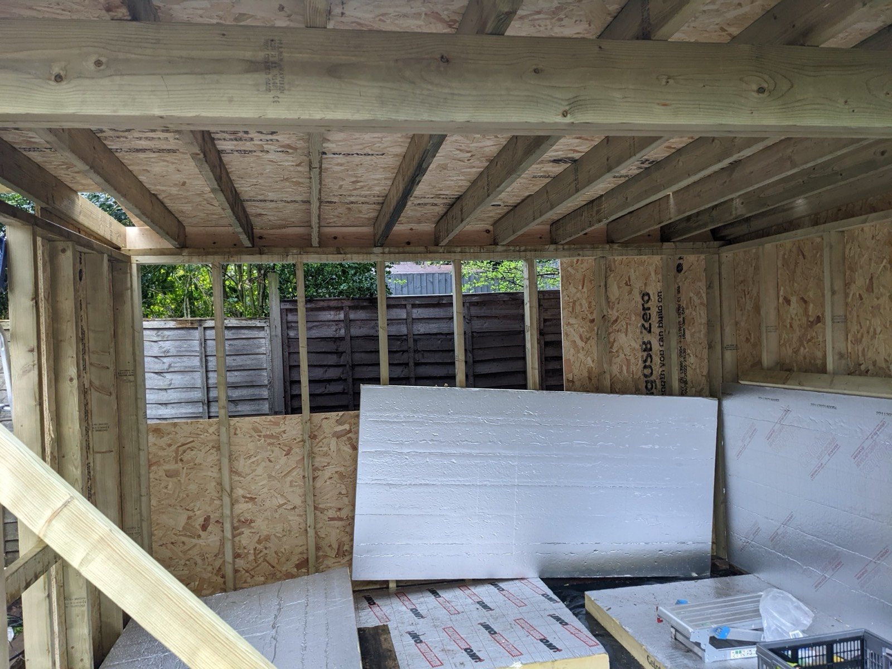

With the concrete base cured, it was time to build upwards and get the building watertight as quickly as possible.

## Wooden Frame

> 1-2 days (screws, wood, screwdrivers, packers, bolts, socket sets, saw)

Once the concrete was dry a 4"x3" wooden frame was bolted down into the concrete. We used long concrete bolts and drilled down into the base.
The picture shows this without the second damp proof course (large plastic sheet) we added. This wooden base was leveled using the long spirit level 
and placing small plastic packers under the wood to get a perfectly level and secure base.

Now we have a base, we can start to build the walls, we worked out what length to cut the uprights in the wall and then cut them all
to the same length, once we had everything we used a long beam along the top (called a wall plate) to start to build the first wall.

You can see the second damp proof course here (black plastic sheet) that went on top of the concrete.

The corners were braced with those large diagonal lengths of wood to stop the frame falling over while we built it. Once you start 
to get the wall timbers screwed onto the frame you no longer need to brace the frame (you will see these later!)

You can also see 3 sheets of the rigid foam insulation we are going to use for the floor. These were put into the frame to give us somewhere to
stand so we didn't rip the plastic sheet (you need to keep it intact to stop any water getting into the building).

Once you have done all 4 walls (leaving a gap for your door and window) you can start to attach the wall panels.

Because I had decided to have a 3m bifold door on the front of the building I used 2 9"x2" timbers screwed together to form the 
top of the doorway. Bifold doors are HEAVY and they hang from above, so big timbers were used, bolted together with coach bolts and we also added an angle iron above the door. You will
see these details in the next few photos because we moved quickly and I didn't get time to take photos of these specifically. 

## Walls

> 1-2 days (screws, wall panels 8x4' 22mm OSB boards, screwdriver )

 

We now have wall timbers we can start to screw in the large 8ft by 4ft boards onto the frame. These give good support to the walls and we made sure the room was
square before screwing these up. The picture shows a few being added with overhang at the top, we cut the overhang off once the roof joists were added (next section) as there
is no need to cut them before.

It's just a case of using a lot of screws here to make sure every board is securely fixed onto the timbers.

## Roof

> 1 day (wood, screws, screwdriver, step ladder, roofing material)

I decided to use a 1:40 pitched roof, this has a slight runoff and I picked heavy duty EPDM membrane (thick rubber sheet) for the roof material. It's easy to install yourself
and you can just lay it out without fixing it down to make your roof watertight very quickly!

This was important because it rained.... A LOT the day we installed the roof so we worked very quickly to get the roof joists, boards and the membrane on. Unfortunately I didn't get 
any other photos, so this one shows all those things done!

