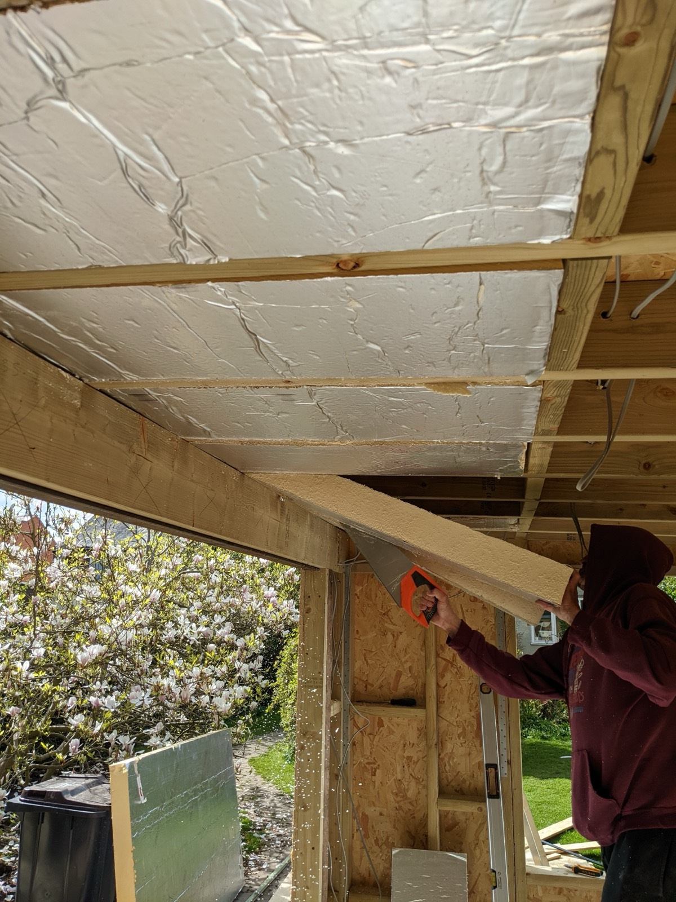
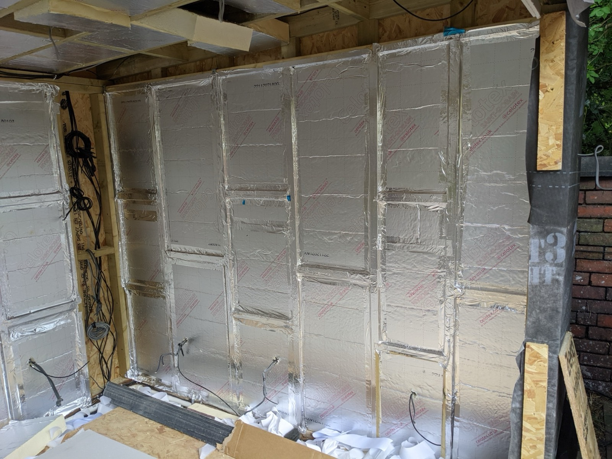
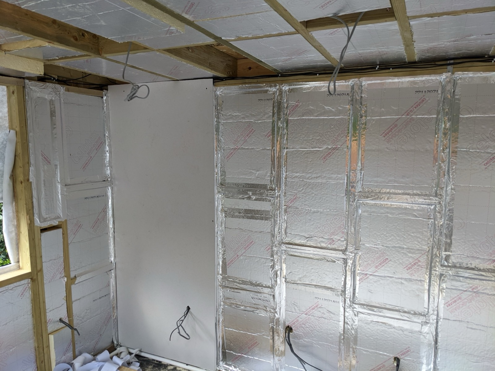
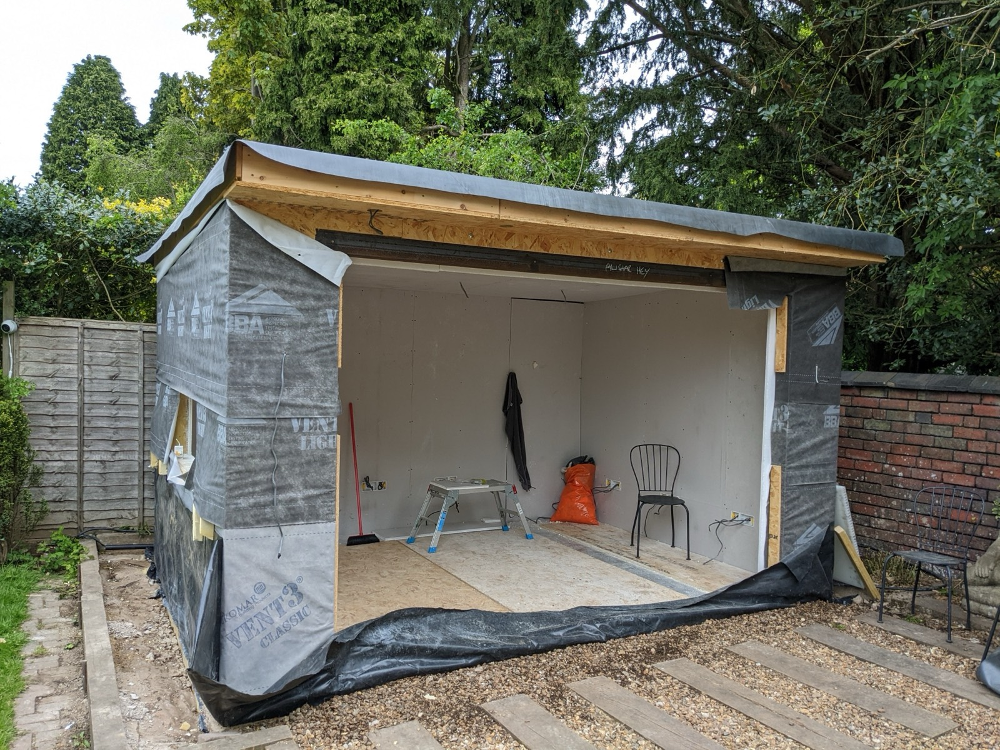
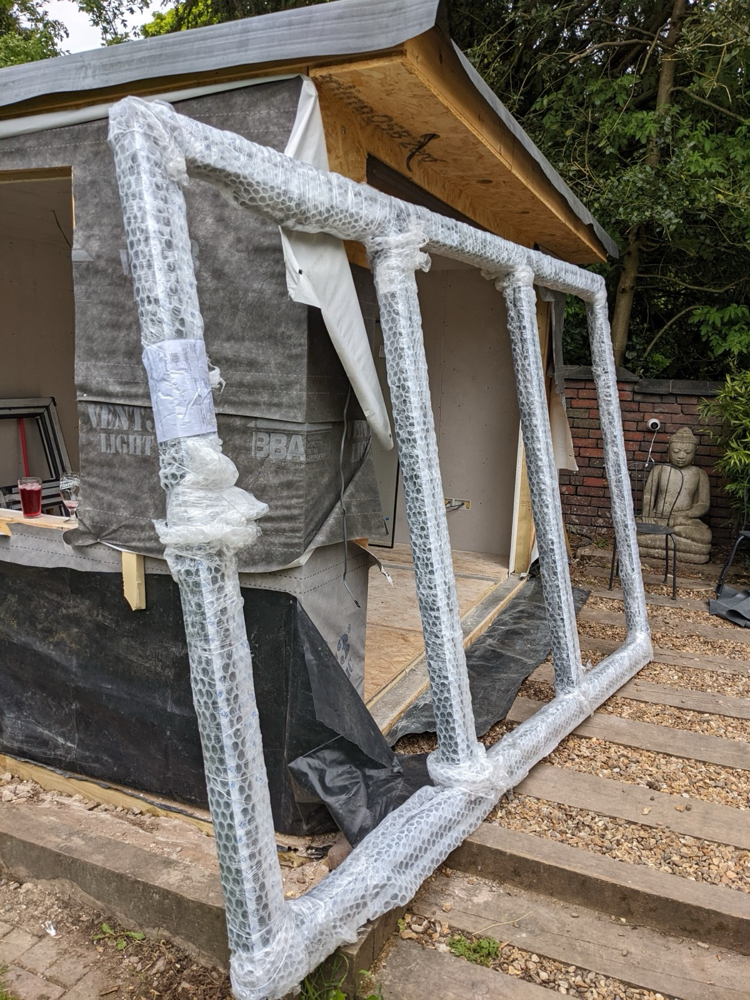
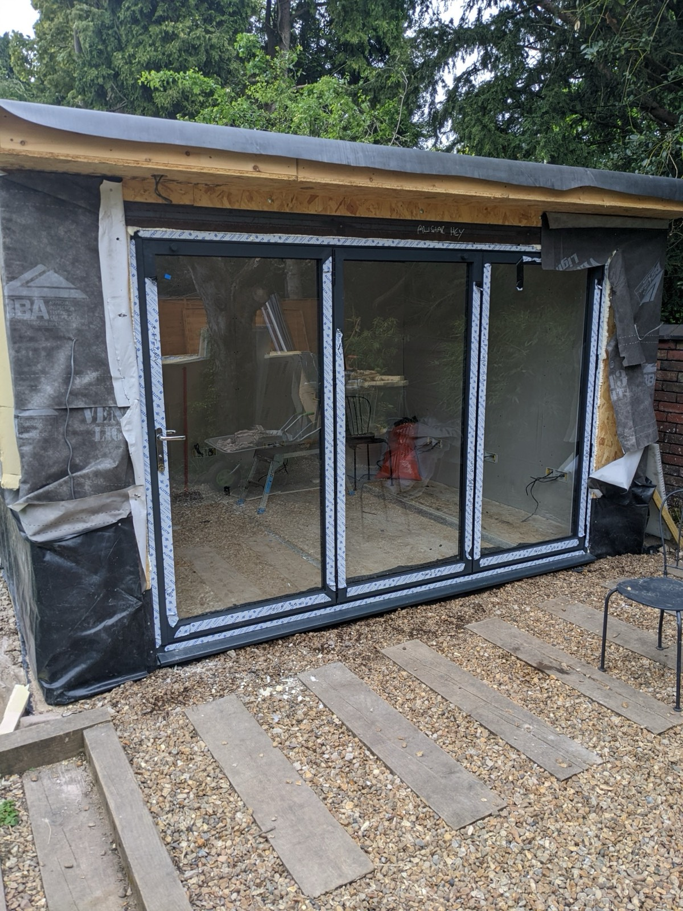
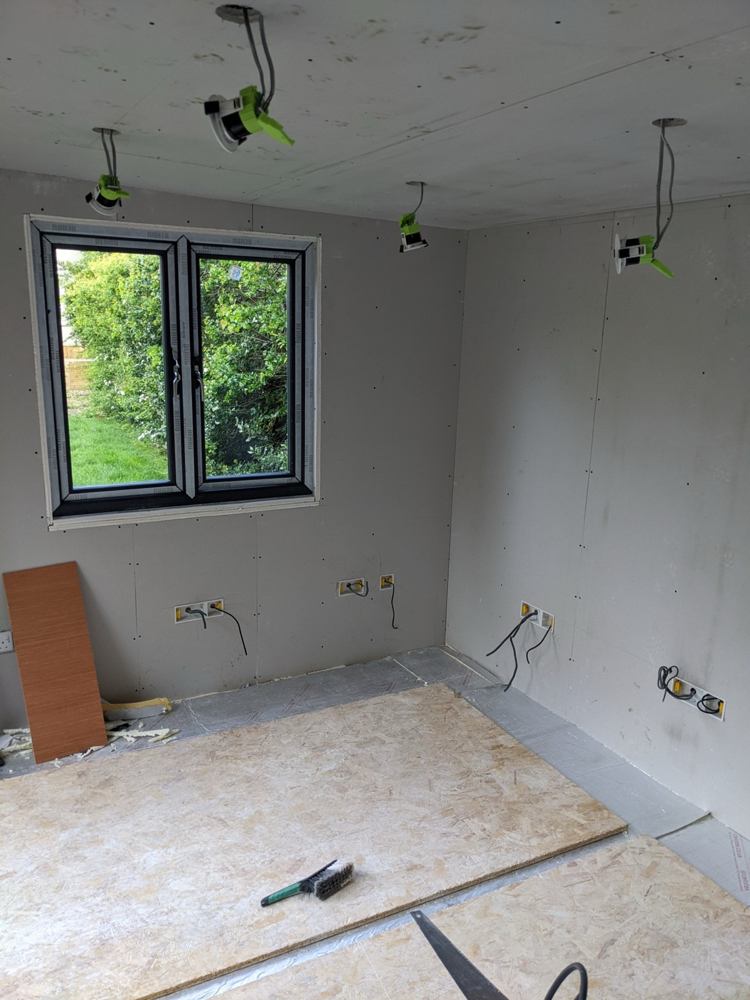

Once the shell was watertight, the work moved inside: cables, insulation, plasterboard, and finally the windows and doors.

## First Fix Electrics 
> Less than 1 day (cable, internet cable)

I went a bit mad with sockets. There are 10 double sockets around the 3 walls (back and 2 sides).  It's easy to add them now and impossible to add them later. 
I also added 10 internet points for the same reason. I'm currently using 2. One for the WIFI router and one for my desktop.

Hint: Get your electrician to do this. 

I'm not going to show pictures (as I don't have any) and didn't do the work.

We went with 5 down-lights on the front (outside), 2 up/down lights and 6 lights inside.

## Insulation

> 1-2 days (saw, insulation, tape measure)

There are a lot of ways to insulate a building. It took a lot of reading to come up with the decision of using 75mm rigid foam
insulation in the walls and 100mm of the same in the floor/ceiling. 

This was picked because of its good "R" value (how good it is at keeping heat in/out) and the fact that the 
wood used for the wall construction was about 90mm deep and we couldn't fit 100mm. 

There are cheaper options! We spent about £1000 on insulation. You could use the fiber stuff on a roll and pay less than £200 
for the room but you would boil in summer and freeze in winter!

As you can see from the picture you cut the big sheets into sections that snugly fit into the gaps between the frame.

Once you have completed the insulation blocks you need to cut out around your lights and sockets. 

Then you tape over the joints, this creates a vapour barrier (keeps moisture from condensing in the wooden frame) and 
helps with keeping the heat in/out. 

> Hint: Don't do what I did and push the insulation to the back of the holes, it should be flush with the 
> front of the frame! I created a section there behind the plasterboard for moisture to condense! I hope it doesn't!

## Plasterboard
> 1-2 days (Plasterboard, plasterboard fixings, saw, stanley knife)

I went for 9.5mm plasterboard with a 12.5mm insulation backing, this is to reduce thermal bridging through the wall timbers.

Your plasterboard needs cutting to size. For the height use the full height of the room. Width needs to end exactly
half way over a wall joist. This is so you can get a good fixing onto the board and wall!

The process is just cut, poke wires through holes and then screw on. The ceiling is hard because those boards are heavy!

## Windows & Doors

> Less than 1 day (Window, Door, screws?)

It's a good idea to get these into the building as soon as the frame is up (or even as part of building the frame).
However, the window and door I ordered had a 3 week lead time and we had to wait.

Once they arrived they were professionally installed (I think most competent DIYers could do this, but a 3m bifold door was a bit daunting for me!)

I don't have any hints/tips on fitting these as I didn't get involved. Here's a picture of the doors fitted

And the window.

