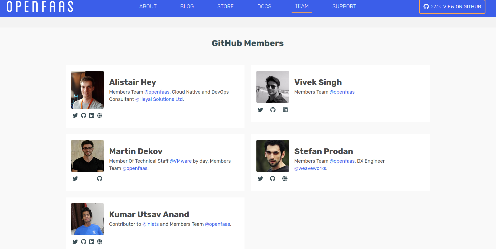

Serverless should let you focus on delivering features into production fast not fiddling with infrastructure.

If you spend some time on the internet you should have seen that kubernetes is everywhere. It's a great platform for abstracting
your infrastructure away from your developers and letting them focus on code.

When it comes to deploying serverless on Kubernetes I am of two minds. Part of me thinks it's not "serverless" because you
have to (at the very least) manage worker nodes (This is not strictly true, you could use AWS Fargate backed EKS Clusters?). 

The other part of me thinks, well you don't have to care about the nodes. We could call it serverless. For example using 
managed Kubernetes with autoscaling worker groups using the cloud's default VM images? You probably would never need to bother 
looking at the instances, let alone connecting to them. 

## Why bring in another abstraction with OpenFaaS

OpenFaaS abstracts away some of the complexity of running applications on kubernetes if you want to focus on delivering
value to your paying customers, who don't care how your platform is run as long as it works.

If you need to run application code, you can run it here. There are community maintained 
templates for languages from Rust and Go to COBOL. If you can't find a template that quite hits the spot you can build and
customise your own to provide exactly the base application configuration that works for you.

Let's look at this from a couple of angles. I'm going to put my Developer and Platform engineer hats on for a minute...

### Developer
You probably don't really mind where your code gets run, as long as you can iterate on features quickly and deploy new 
services without fuss. 

I'm going to let you into a secret, you need to write A LOT of YAML to deploy a service into kubernetes, most of it will be 
the same, or very similar. 

In this case using plain old YAML manifests hand crafted for each service probably isn't your bag. 

It takes 2 commands to deploy a service into OpenFaaS. 
```sh
$ faas-cli new --lang python3 python3-fn --prefix <dockerhub username>

$ faas-cli up -f python3-fn.yml
```

To get the same container deployed into Kubernetes using YAML manifests you would need:
* A Service (If you are going to scale your deployment) (20+ lines of YAML)
* A Deployment (50+ lines of YAML)
* An Ingress Definition (20+ lines of yaml)
* A Dockerfile (20+ Lines of Dockerfile)

Do you really want to get stuck maintaining all of these for each service you are running? 

In addition to this you can easily install and run OpenFaaS on your laptop using docker swarm or a local Kubernetes cluster.

I like using [`k3d`](https://github.com/rancher/k3d) for local testing. I can spin up a single node cluster inside docker
install OpenFaaS and route traffic to my local machine in a few commands. 

```sh 
$ k3d create
# Wait for that to finish, It will output a command to export KUBECONFIG

$ export KUBECONFIG="$(/usr/local/bin/k3d get-kubeconfig --name='k3s-default')"


# I'm using arkade to install openfaas with default config https://github.com/alexellis/arkade
$ arkade install openfaas


# When thats deployed (all pods running, check with kubectl get pods -A)
$ PASSWORD=$(kubectl get secret -n openfaas basic-auth -o jsonpath="{.data.basic-auth-password}" \ 
    | base64 --decode; echo)

# Port forward the "gateway" to your localhost
$ kubectl port-forward -n openfaas svc/gateway 8080:8080 &

# Login with the CLI
$ echo -n $PASSWORD | faas-cli login --username admin --password-stdin


# Deploy your stack, which by default should be in stack.yml
$ faas-cli up

```

It would be easy to include this in your CI pipeline. For example the Kubernetes provider for OpenFaaS 
[faas-netes](https://github.com/openfaas/faas-netes/) uses minikube to run OpenFaaS during CI.

### Platform/Ops engineer

You want to provide a stable, simple to use and easy to debug platform for developers to maximise productivity.

If you are on a small team or don't have bags of kubernetes experience then leveraging a platform like OpenFaaS that 
abstracts away some of the complexity for you and your users seems like a good idea.

If you want to focus on delivering a stable scalable platform for your services you can leverage the many 
thousands of hours of community knowledge and experience that has gone into building OpenFaaS. If you wanted to build
a custom solution you would no doubt end up hitting some of the same problems that have already been overcome by the 
OpenFaaS contributors. Why go to all that effort yourself? 

----

## My journey with OpenFaaS

### First look
My first experience with OpenFaaS was during a company "hack day" where you put aside your normal work and get into new
teams and experiment with new technologies and processes. Our team decided to look into open source serverless technology 
as an alternative to your favourite cloud vendor serverless technology.

We were trying to find a way of overcoming the difficult challenge of testing serverless deployments End to End in a
cost effective, fast and easy to test way.

I have always found services like AWS Lambda too hard to test, run locally and debug without deploying the whole stack
into Amazon and trying things until it works. Our feedback loop for an End to End test on a AWS based serverless stack was
in excess of 30 minutes! Not to mention the costs for deploying and running on the cloud.

Needless to say, within a few days we had written a serverless application on OpenFaaS. We had a range of languages in use 
for our functions (we all picked our favourites!), and we could all run the stack locally for testing. 

----
### Where am I now?

I'm part of the community and a regular contributor to OpenFaaS in my spare time.


(sorry everyone else who didn't fit onto that screenshot!)


I love OpenFaaS! I think it's the perfect platform for developing cloud native applications. It keeps its focus firmly on 
providing developers with the best tools and workflows to get things done. 

I may be slightly biased: I contribute a lot of code to the OpenFaaS project! At the time of writing I was the 9th highest 
contributor by commits.


## Come and join the party!

At the time of writing there were more than 2,500 of us in the OpenFaaS community, and 20K+ stars on GitHub!


What can you do to get involved? Well lots of things!

* OpenFaaS has a great community - [find out how to join here](https://docs.openfaas.com/community/)
* Check out the [OpenFaaS Website and blog](https://openfaas.com)
* Head over to Github and run through the [getting started Workshop](https://github.com/openfaas/workshop#openfaas-workshop)
* Follow OpenFaaS on [Twitter](https://twitter.com/openfaas)
* Support the project's maintainer [Alex Ellis](https://github.com/sponsors/alexellis) by sponsoring him on Github! 


----
