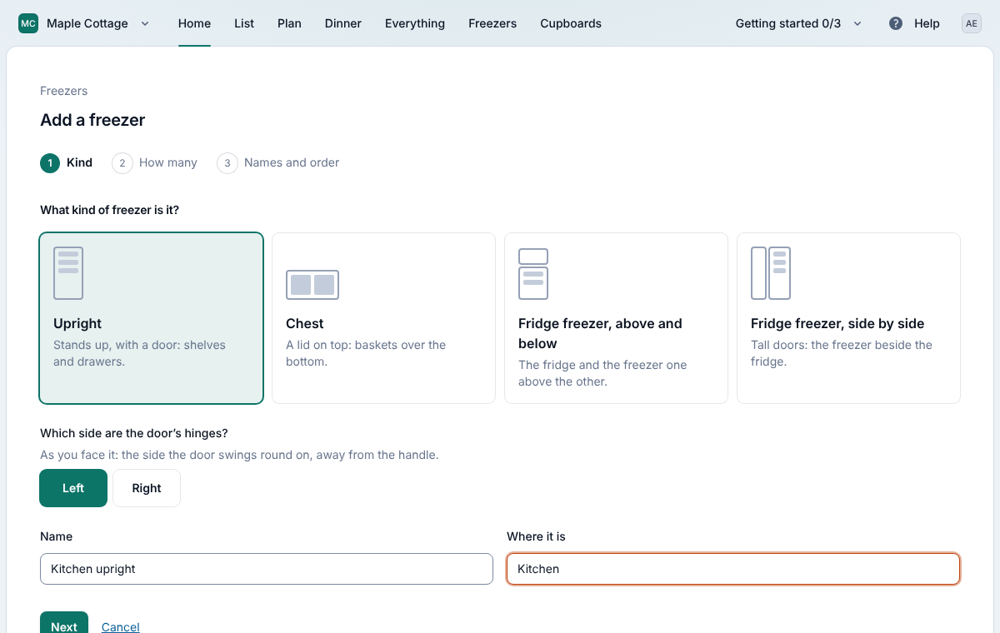
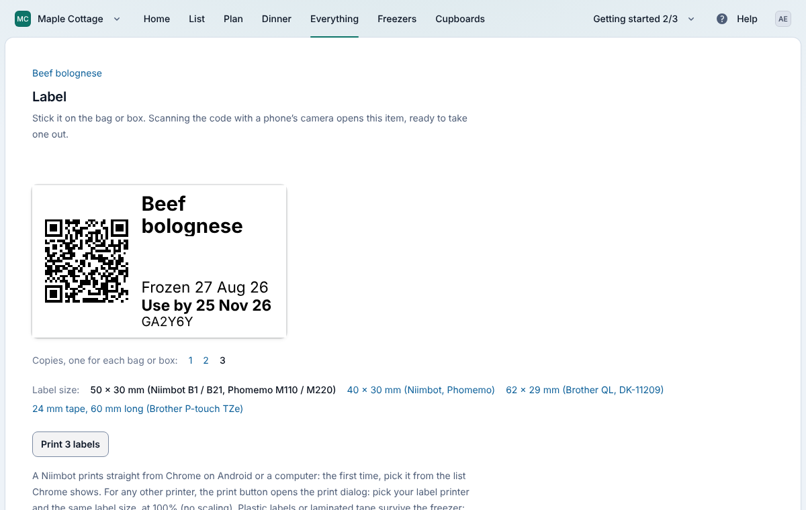
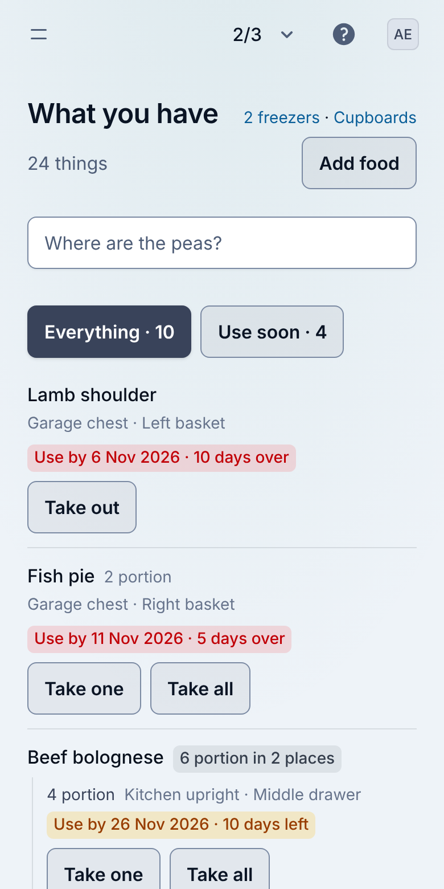
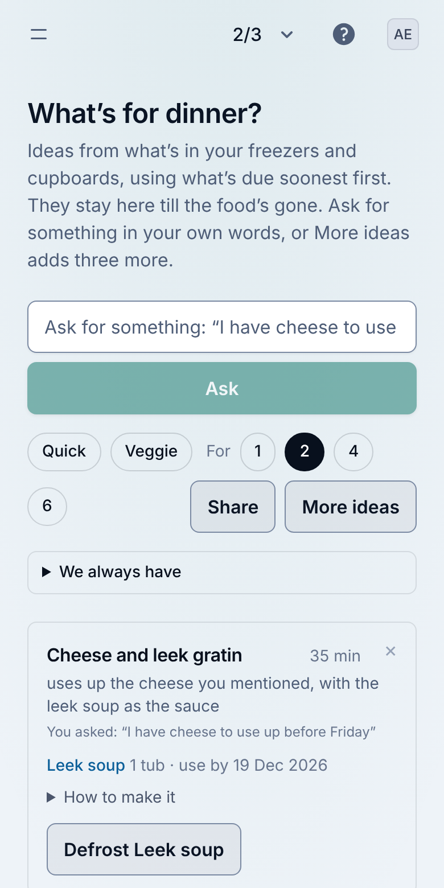

Every freezer has one: a frosted tub, no label, contents and age unknown. Ours had several. So the first real app
on the platform from [Multi-tenancy by construction](/blog/multi-tenancy-shared-tables-or-database-per-tenant/)
became a household freezer app, and it's the one we use every day.

It's a small, slightly silly problem, which made it a good test. A real app with real users finds the gaps a
demo app never will, and every gap it found was fixed in the platform, not patched into the app.

## What it does

- **Set up your freezers.** Pick the kind (upright, chest, fridge freezer, side by side), say how many shelves,
  drawers and door shelves, then name them and drag them into order on a drawing of the freezer.
- **Add food in one form.** What it is (typed, or scan a barcode), how many, where it's going, and its use-by date.
- **Print a label.** A small label printer prints the name, dates and a QR code. Scanning the code opens that item,
  ready to take one out or move it.
- **See what to use soon**, what's defrosting, and what's running low, with a phone notification each evening and a weekly email of what's due.
- **Plan the week.** A shopping list, a meal plan and recipes, which read from what's in the freezer.
- **Ask what's for dinner.** Ideas from what you have, using what's due soonest first.





## A household is a tenant

The platform says "tenant"; the app says "household". Everyone in a household sees the same freezers. You invite
people by email, and a viewer can look but not change anything, which is exactly right for someone who only
wants to check whether there's any ice cream left.

Households are kept apart the same way every tenant is: Postgres Row-Level Security, tenant context set by the
platform, and the [cross-tenant test harness](/blog/multi-tenancy-cross-tenant-test-harness/) run against every
route the app has.

## What the app didn't have to build

This is the point of the exercise. The app's own code is its tables, its API routes and its pages. Everything else
comes from the platform:

| The platform gives it | So the app doesn't build |
| --- | --- |
| Sign-in, invitations, the household picker | Accounts, passwords, email links |
| Roles and permissions | Its own access control |
| Tenant context and RLS | `where household_id = …` on every query |
| Audit of every change | An audit table |
| Email, push notifications, scheduled jobs | SMTP, VAPID keys, a cron server |
| File storage behind a signer | Buckets and storage credentials |
| A relay to Claude | An API key, or a way to leak data to it |

A route in the app is about this much code. It names a permission, runs inside the platform's transaction, and
never mentions the household, because the database already knows which one it is:

```ts
app.get('/api/freezer/freezers', { config: { access: { permission: 'freezer:read' } } }, () =>
  db.tx((trx) => trx.selectFrom('app.freezers').selectAll().orderBy('name').execute()),
);
```

Forget the permission and the app won't start. Add a table without RLS and the migration gate fails the rollout.

## An installable web app, not a native one

It installs from the browser to a phone's home screen and opens like any other app, with notifications for food
that's due. A native app would have meant two app stores and a review queue for an app used by one household. A web app
meant shipping several times a day.



## Dinner ideas, without handing over the household

"What's for dinner?" asks Claude for a few ideas from what's in the freezers and cupboards, using what's due
soonest first. You can ask in your own words: "I have cheese to use up before Friday".

The app has no API key and doesn't talk to Claude directly. It goes through the platform's relay, and each use is
declared up front with what it sends: food names, quantities and dates. Never people's names, emails or ids. The
relay is the one place to check, limit and audit what leaves the platform, for every app.



## What using it every day taught us

The first version had a button for everything. Daily use pared it back: adding and removing food first, everything
else a tap away, and moving food using the same picker as adding it. None of that came from a spec. It came from
standing at an open freezer with cold hands.

It also found real platform gaps: apps needed to publish their own events, keep per-device settings, and send push
notifications. Each became a platform feature with a release, so the next app gets it on day one.

## Why build a toy?

Because a platform with no app on it hasn't been tested. The freezer app runs on staging every day, it's the app
the end-to-end isolation and restore tests run against, and it's the first thing that breaks when the platform
does. If you're building a platform for other teams, build something small and real on it yourself, and use it.
